# Sơ đồ EER: Quản lý cấu trúc sản phẩm (Laptop)

**Phiên bản:** 0.1, dựa trên `docs/business-spec.md` (các quy tắc BR-01 đến BR-18)

## 1. Các quyết định thiết kế

Nhóm chưa chốt các câu hỏi ở mục 10 của đặc tả, nên bản này dùng phương án mặc định. Nếu nhóm chọn khác thì chỉ cần sửa mục này và sơ đồ.

| Vấn đề | Quyết định mặc định | Lý do |
|---|---|---|
| `SanPham` là thực thể riêng hay cụm ở gốc? | **Thực thể riêng.** Mỗi `PhienBan` trỏ tới một `CumLapRap` gốc. | Tách rõ "sản phẩm bán ra" (có nhiều phiên bản) khỏi "cụm lắp ráp" (cấu trúc kỹ thuật). Dễ giải thích phiên bản. |
| Chuyên biệt hóa `ThanhPhan` | **Rời nhau (d), toàn phần.** 3 lớp con: `CumLapRap`, `LinhKienCoKhi`, `LinhKienDienTu`. | Theo BR-02. Quạt là cụm nên không cần chồng lấn (overlapping). |
| Cấu thành gắn phiên bản thế nào? | **Thực thể kết hợp `CauThanh`** có 3 khóa ngoại (phiên bản, cha, con) và thuộc tính `so_luong`. | Quan hệ bậc ba (phiên bản, cha, con) có thuộc tính, nên tách thành thực thể cho rõ khóa. |

## 2. Sơ đồ

Mermaid không có ký hiệu chuyên biệt hóa (hình tròn d) nên các lớp con được vẽ bằng quan hệ "1 – 0..1" với `ThanhPhan` cùng khóa chính. Ký hiệu chuẩn của EER có ở mục 3 để vẽ lại bằng diagrams.net.

```mermaid
erDiagram
    SAN_PHAM ||--|{ PHIEN_BAN : "co"
    PHIEN_BAN }o--|| CUM_LAP_RAP : "co goc la"
    PHIEN_BAN ||--o{ CAU_THANH : "gom"
    THANH_PHAN ||--o{ CAU_THANH : "la cha (cum)"
    THANH_PHAN ||--o{ CAU_THANH : "la con"

    THANH_PHAN ||--o| CUM_LAP_RAP : "chuyen biet"
    THANH_PHAN ||--o| LINH_KIEN_CO_KHI : "chuyen biet"
    THANH_PHAN ||--o| LINH_KIEN_DIEN_TU : "chuyen biet"

    SAN_PHAM {
        string ma_sp PK
        string ten_sp
        string mo_ta
    }
    PHIEN_BAN {
        string ma_pb PK
        string ma_sp FK
        string so_hieu
        date ngay_tao
        string trang_thai "nhap, phat_hanh, ngung_dung"
        string ma_tp_goc FK "tro toi CumLapRap"
    }
    THANH_PHAN {
        string ma_tp PK
        string ten_tp
        string mo_ta
        string loai "CUM, CO_KHI, DIEN_TU"
    }
    CUM_LAP_RAP {
        string ma_tp PK, FK
    }
    LINH_KIEN_CO_KHI {
        string ma_tp PK, FK
        decimal don_gia
        string vat_lieu
        decimal dung_sai
    }
    LINH_KIEN_DIEN_TU {
        string ma_tp PK, FK
        decimal don_gia
        decimal dien_ap
        decimal cong_suat
    }
    CAU_THANH {
        string ma_pb PK, FK
        string ma_cha PK, FK
        string ma_con PK, FK
        int so_luong
    }
```



## 3. Mô tả theo ký hiệu EER chuẩn (để vẽ lại trên diagrams.net)

**Thực thể mạnh:** `SanPham`, `PhienBan`, `ThanhPhan`.

**Chuyên biệt hóa:**

```
                 ThanhPhan
                    |
                   (d)        d = disjoint (rời nhau)
          ┌─────────┼──────────┐   đường đôi từ ThanhPhan = total (toàn phần)
          |         |          |
     CumLapRap  LinhKienCoKhi  LinhKienDienTu
                 (don_gia,      (don_gia,
                  vat_lieu,      dien_ap,
                  dung_sai)      cong_suat)
```

Thuộc tính `don_gia` có thể nâng lên một lớp con trung gian `LinhKien` (gồm `LinhKienCoKhi` và `LinhKienDienTu`) để không lặp. Xem phương án B ở mục 6.

**Mối quan hệ:**

| Quan hệ | Giữa | Bội số | Ghi chú |
|---|---|---|---|
| Có | `SanPham` – `PhienBan` | 1 – N, `PhienBan` tham gia toàn phần | Mỗi phiên bản thuộc đúng một sản phẩm |
| Có gốc là | `PhienBan` – `CumLapRap` | N – 1 | Mỗi phiên bản có đúng một cụm gốc |
| Cấu thành | `PhienBan`, `ThanhPhan` (vai trò **cha**), `ThanhPhan` (vai trò **con**) | Bậc ba, thuộc tính `so_luong` | Quan hệ đệ quy nhiều – nhiều, vẽ thành thực thể kết hợp `CauThanh` |

## 4. Ràng buộc không biểu diễn được trên sơ đồ

Các ràng buộc này phải cài bằng trigger, CHECK hoặc phương thức, và cần ghi trong báo cáo.

| Mã | Ràng buộc | Cách cài đặt (dự kiến) |
|---|---|---|
| BR-06 | `ma_cha` trong `CauThanh` phải là `CumLapRap` | Quan hệ: khóa ngoại tới bảng `CumLapRap`. Đối tượng: kiểu của thuộc tính tập hợp |
| BR-08 | `so_luong` là số nguyên dương | `CHECK (so_luong > 0)`; kiểm tra trong phương thức |
| BR-09 | Mỗi (phiên bản, cha, con) chỉ một lần | Khóa chính ba cột; đối tượng dùng `Map` thay `List` |
| BR-10 | Cấm chu trình | Trigger dùng truy vấn đệ quy; đối tượng: phương thức `kiemTraChuTrinh()` |
| BR-14 | Phiên bản đã phát hành không được sửa cấu trúc | Trigger kiểm tra `trang_thai` của phiên bản |
| BR-15 | Cụm trong phiên bản đã phát hành phải có con | Kiểm tra khi chuyển trạng thái sang phát hành |
| BR-02 | Mỗi thành phần đúng một lớp con | Khóa chính chung kèm cột `loai`; trigger hoặc khóa phức hợp `(ma_tp, loai)` |

## 5. Ánh xạ sơ bộ sang lược đồ quan hệ

Chưa chuẩn hóa, sẽ phân tích kỹ ở tuần 4-5.

```
SanPham(ma_sp PK, ten_sp, mo_ta)
PhienBan(ma_pb PK, ma_sp FK, so_hieu, ngay_tao, trang_thai, ma_tp_goc FK)
ThanhPhan(ma_tp PK, ten_tp, mo_ta, loai)
CumLapRap(ma_tp PK/FK)
LinhKienCoKhi(ma_tp PK/FK, don_gia, vat_lieu, dung_sai)
LinhKienDienTu(ma_tp PK/FK, don_gia, dien_ap, cong_suat)
CauThanh(ma_pb FK, ma_cha FK -> CumLapRap, ma_con FK -> ThanhPhan, so_luong,
         PK(ma_pb, ma_cha, ma_con))
```

## 6. Phương án thay thế (nên cân nhắc, ghi vào báo cáo)

| Phương án | Nội dung | Ưu | Nhược |
|---|---|---|---|
| **A (mặc định)** | Mỗi lớp con một bảng, bảng chung `ThanhPhan` | Rõ ràng, không có NULL thừa | Truy vấn đa hình phải JOIN |
| **B** | Thêm lớp con trung gian `LinhKien` chứa `don_gia` | Không lặp `don_gia` | Thêm một cấp chuyên biệt hóa |
| **C** | Một bảng duy nhất, nhiều cột, cột `loai` | Truy vấn đơn giản, nhanh | Nhiều NULL, khó ràng buộc |

Nên thực nghiệm so sánh A và C nếu còn thời gian (đã nêu trong kế hoạch tuần 6-8).

## 7. Ánh xạ sơ bộ sang mô hình hướng đối tượng

```
SanPham { ma, ten, Set<PhienBan> cacPhienBan }
PhienBan { soHieu, ngayTao, trangThai, CumLapRap goc }
ThanhPhan (trừu tượng) { oid, ma, ten, moTa }
  ├─ CumLapRap { Set<ThanhPhanSoLuong> thanhPhanCon }
  ├─ LinhKienCoKhi { donGia, vatLieu, dungSai }
  └─ LinhKienDienTu { donGia, dienAp, congSuat }
ThanhPhanSoLuong { ThanhPhan tp, int soLuong }
```

Điểm khác biệt cần bàn: trong mô hình đối tượng, cấu trúc của **từng phiên bản** có thể là một cây đối tượng riêng (cụm gốc của phiên bản), còn mô hình quan hệ dùng khóa `ma_pb` để tách phiên bản. Phần này sẽ làm rõ ở tuần 9-10.
